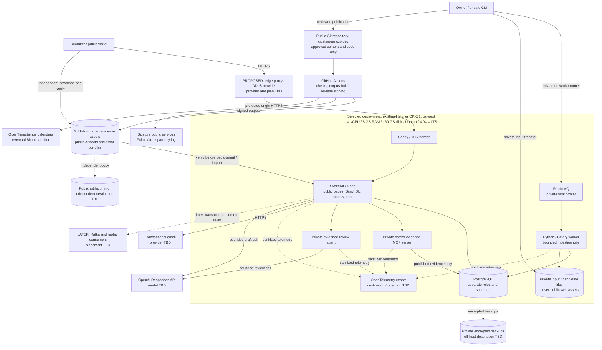
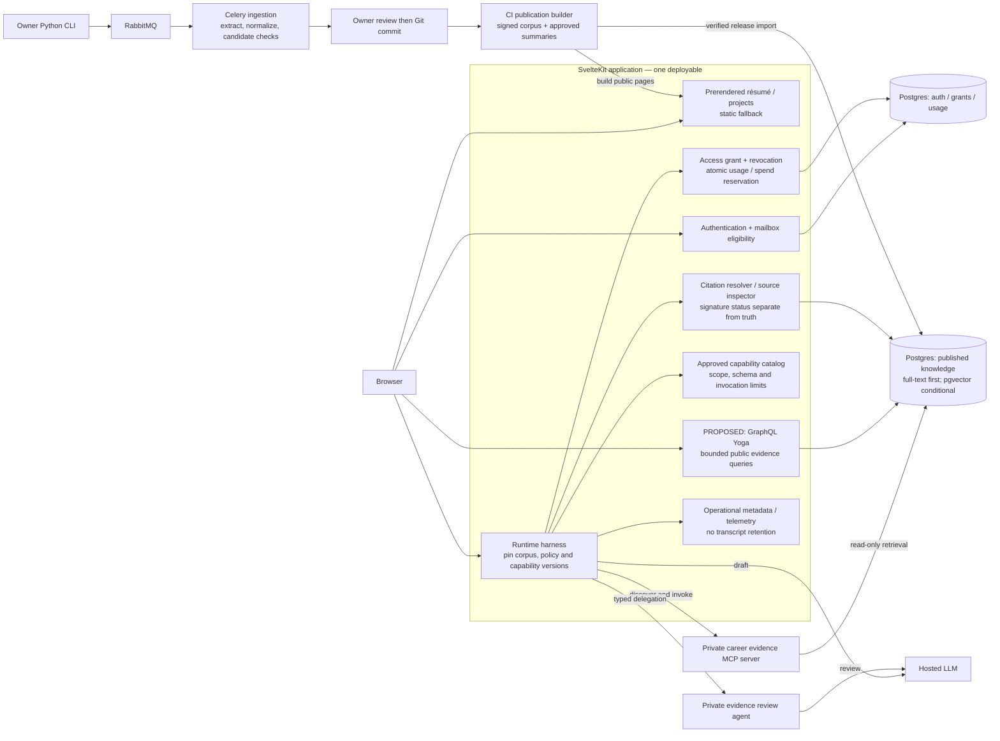
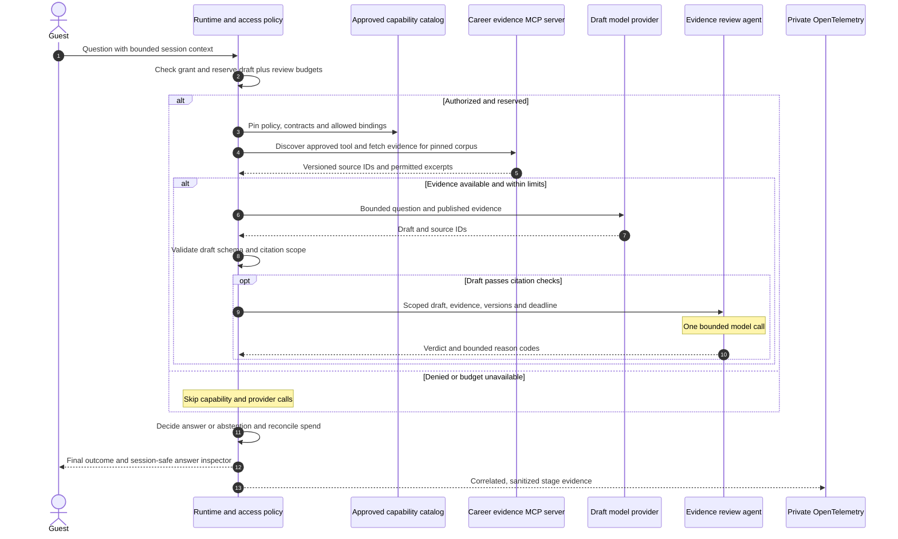
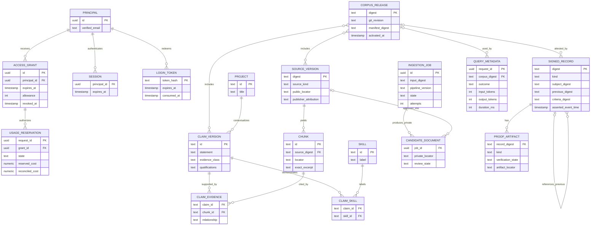
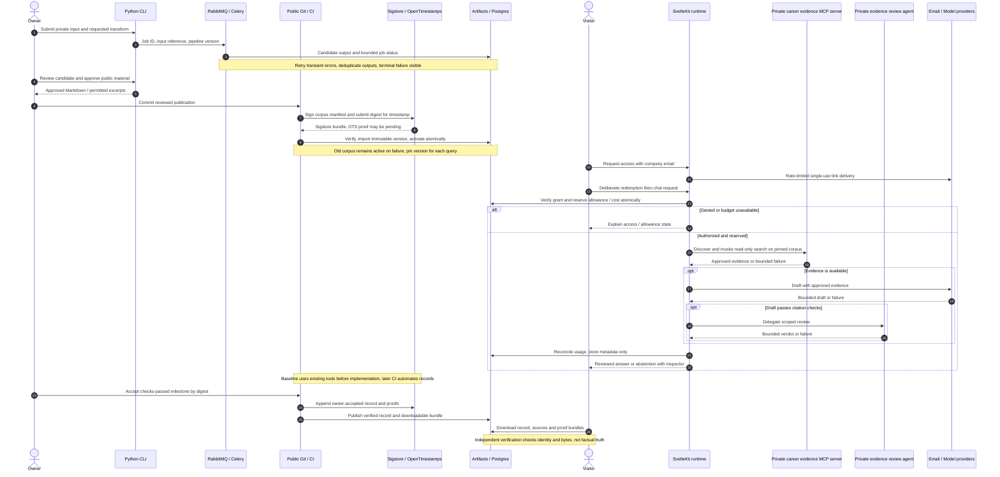

# Architecture

Planning revision 0.3 · 2026-10-19 · implementation defaults accepted; deployment unverified · [decision register](decisions.md).

2026-11-23 planning addendum · proposed [agent runtime](#agent-runtime-and-federated-integrations) for the production prototype.

## Boundaries and intent

Use one SvelteKit web application, one PostgreSQL service, and a Python content toolchain with RabbitMQ/Celery. Chat is synchronous/streaming HTTP and does not wait on the ingestion queue. The prototype places the agent runtime in SvelteKit and runs two private capability processes on the same host. Repo and deployment share a release target while the two capabilities retain separate contracts and permissions. The owner CLI is the initial Celery producer; TypeScript does not implement Celery's task protocol. Public GraphQL reads only published evidence. Approved content and publication artifacts bridge private preparation and public delivery.

Diagrams are skeletons, not deployed-state claims. Labels `PROPOSED`, `TBD`, and `LATER` identify unresolved placement or deferred components. Arrows represent permitted logical flows, not unrestricted network access. Standalone `.mmd` files are the diagram editing source; embedded copies below must remain identical.

## System level

People, deployments, external services, and trust boundaries. Broker and database ports are private. Public artifacts, their independent mirror, and private encrypted backups have separate destinations and credentials.

[Standalone system diagram](diagrams/system.mmd)

The existing Hetzner host was selected for launch on 2026-10-19, subject to live capacity and ingress verification. On 2026-10-12, the owner supplied the inventory and confirmed nothing substantial is currently running; the host has not been inspected. The existing hosting bill is outside the US$20–50 additional monthly project budget. A single host is not highly available. If ingestion disrupts chat, move or run ingestion on demand before increasing architecture complexity. Any co-tenants must have separate credentials, volumes and resource budgets. The origin address belongs in deployment configuration; it is unnecessary in public architecture diagrams.

### Initial VPS resource envelope (proposed)

These are starting container memory ceilings to validate, not measured consumption or guarantees. Keep one Celery task executing at a time initially and bound ingestion CPU to approximately one vCPU. Build images and run browser suites in CI or development, outside the production host.

| Component | Proposed memory ceiling | Placement / constraint |
|---|---|---|
| SvelteKit / Node | 768 MiB | One web process; hosted model calls, no local model. |
| PostgreSQL | 1,536 MiB | Small bounded connection pools; tune query memory within this envelope. |
| RabbitMQ | 1,024 MiB | Small task-reference messages; bounded queue backlog. |
| Celery worker | 1,024 MiB | One concurrent task; text-bearing PDFs with input/time limits. |
| Caddy | 256 MiB | Coordinate ports and routing with any existing ingress. |
| Telemetry exporter / optional collector | 256 MiB | Bounded buffers; no full local observability cluster. |

The listed ceilings total 4.75 GiB before sizing the private MCP and review processes. Measure both alongside the app and Postgres before selecting limits. Defer or run ingestion on demand if the combined services leave insufficient headroom for the OS, deployments or recovery. No substantial competing workload is currently reported. Measure actual usable RAM before choosing limits and review the allocation if another project is deployed later. Confirm recovery from a worker memory-limit termination and test chat/retrieval with ingestion active.

For RabbitMQ, initially evaluate an absolute 512 MiB memory alarm below its 1 GiB container ceiling. The alarm throttles publishers; it is not a hard memory cap, and transient overhead needs headroom ([RabbitMQ guidance](https://www.rabbitmq.com/docs/memory)).

Use separate persistent volumes, bounded log/image/candidate retention and disk-pressure alerts. Provisionally keep at least 30 GB disk free for database, upgrade and recovery headroom; validate against actual disk usage. Store encrypted database backups off-host and test restoration. Add Kafka or security labs only after reviewing their additional resource needs. Hosting and variable-service allocations are tracked in the [budget decision](decisions.md#budget-and-capacity-update--2026-10-12).

## Application level

Runtime modules and the independent publication path. Every AI request passes eligibility, session, grant, and atomic cost checks before the provider call. Chat receives only publication-approved evidence; ingestion cannot activate a corpus.

[Standalone application diagram](diagrams/application.mmd)

### Publication and retrieval

1. CLI submits a reference to bounded private input. Do not put whole PDFs or sensitive text into broker messages.
2. Worker extracts and normalizes candidate text with lineage, page/section locators and pipeline version. It writes only private candidate state.
3. Owner reviews accuracy, attribution, source permissions and public suitability. Approved Markdown and permitted excerpts enter public Git through a deliberate export.
4. CI builds a corpus snapshot using the same versioned Python transformation code via a deterministic CLI entry point. This need not run through RabbitMQ. Optional model-authored summaries must be reviewed and frozen before signing.
5. CI checks corpus references and evaluations, signs the manifest, starts OpenTimestamps, and publishes immutable artifacts. A privileged publication command verifies signatures and checksums, stages the version, and changes the active corpus pointer atomically.
6. A chat request pins one corpus digest for retrieval and citation resolution. A deployment pins matching public pages, GraphQL views and corpus; health checks detect revision mismatch. Old versions remain available for existing citations.

Start retrieval with PostgreSQL full-text search and explicit metadata filters. Evaluate paraphrases and ambiguous questions; introduce `pgvector` only if it closes a measured gap. Embedding configuration and corpus version then become part of the publication manifest. Do not treat company background as evidence of Justin's personal contribution.

### Interfaces

| Boundary | Proposed contract | Important constraint |
|---|---|---|
| Browser → public pages | Prerendered HTML / static assets | Core résumé and contact useful without JavaScript or chat. |
| Browser → GraphQL | Read-only evidence queries, bounded pagination, approved operation set | No private candidate, identity, usage or telemetry schema exposure. |
| Browser → authentication | Magic-link request and deliberate confirmation/redeem | Plain link tokens never enter logs; requests have generic responses and layered rate limits. |
| Browser → chat | Authenticated POST, bounded status events, completion with source IDs and corpus digest | The prototype buffers factual answer text until checks and review pass. |
| Runtime → capability integrations | Private MCP discovery/invocation and a typed review request/result | Versioned capability catalog; explicit caller identity, data class, deadline and pins. |
| Owner CLI → broker | Native Celery protocol, JSON arguments containing job IDs and private input references | Reject unsafe serializers; private authenticated transport. |
| Worker → candidate store | Idempotent result keyed by input digest, transformation version and options | An extraction retry cannot publish or duplicate a corpus. |
| CI → deployment | Versioned release manifest, build and corpus digests, proof bundles | Verify expected identity and immutable bytes before activation. |
| Future producer → Kafka | Versioned sanitized event envelope | Introduce outbox with the Kafka slice; never rely on events for live authorization or spending. |

Exact routes and schema field names are implementation contracts to approve in the relevant slice, not frozen API promises in this draft.

## Agent runtime and federated integrations

The proposed [production prototype](srs.md#production-prototype-acceptance) has two harnesses with different jobs. The runtime harness owns the request lifecycle, scoped context, capability dispatch, limits, output checks and recovery. The evaluation harness runs fixed questions against versioned policies and measures which behavior earns release acceptance.

[Standalone runtime diagram](diagrams/agent-runtime.mmd)

| Component | Owns | Interface and authority |
|---|---|---|
| Runtime in SvelteKit | Session and grant checks, atomic reservation, per-turn context, capability routing, final answer/citations and session-safe projection | Pin corpus, capability catalog and policy per request. Route only registered capabilities. Draft with a bounded model call. Validate both the draft and reviewer response and decide the user-visible outcome in code. |
| Career evidence MCP server | Read-only retrieval and source result contract over the approved corpus, backed by PostgreSQL full-text search | Independently addressable private service. Discover and invoke a bounded search capability with the pinned MCP SDK/protocol version. Accept bounded query, corpus digest and result limit from the authorized runtime. Return exact excerpt, evidence class, source/chunk IDs and corpus digest. Its scoped DB role reads published data only. No provider access. |
| Evidence review agent | Independent model-backed assessment of whether draft claims follow from the selected evidence | Independently addressable private service using a typed request/result contract. Receive only the current question, scoped draft and evidence, pinned versions, opaque execution ID and deadline. Return a verdict and bounded reason codes anchored to claim/citation IDs. Outbound calls are limited to its configured model path and payload-free telemetry. No access to DB, MCP, publishing, visitor grants, or prior conversations. |
| Evaluation runner | Versioned case manifests, human judgments, reports and reproducibility commands | Run both policies outside guest traffic against a frozen snapshot. Use fakes for routine CI failures and bounded live comparisons for quality claims. Record the policy selected and its tradeoff. |

Use a checked-in, deploy-time catalog with one record per capability. Minimum fields are stable ID, owner, contract/schema version, implementation revision, allowlisted binding, caller/scope, accepted data class, deadline, invocation limit and enablement. Validate records and discovered tool schemas before use. The runtime owns routing, and the private service enforces its own caller, contract and input restrictions. Tool output and draft content are untrusted data. Registry entry, schema validation, and authorized capabilities constrain what executes. Reject unknown IDs, incompatible versions and mismatched corpus digests. A compatible alternative behind the same contract must replace a binding without changing caller logic. Rehearse upgrade/disable and recovery with contract validation, readiness and timeout; keep credentials and private addresses out of the public projection.

The prototype uses private MCP Streamable HTTP with a compatible pinned SDK and an authenticated private typed HTTP review interface. Confirm compatibility in a focused spike. The design can demonstrate independent versioning, constrained contribution and failure isolation on one host. A2A conformance, independent teams, multi-provider routing, durable agent execution and persistent cross-session memory require separate work. The current review interface uses the project's own contract. See the [protocol references](sources.md#agent-runtime-and-evaluation).

Maintain only a bounded, ephemeral conversation window. Validate any resubmitted state; each turn retrieves fresh, version-pinned evidence. Do not send login state, private sources, all conversation history, or scope tokens to models. Bound the runtime to one retrieval, one draft and at most one review model call per turn in the initial configuration. Reserve the maximum permitted cost for each paid stage in a single atomic authorization before either stage can dispatch. Internal review may send one bounded provider call only from an authenticated, authorized execution with a live deadline; deduplicate execution or prohibit automatic resends across the review boundary. The app reconciles known usage once and retains conservative accounting for ambiguous sends. Disable paid AI centrally. Publish no factual draft before deterministic citation checks and a passing review. Show stage-only progress, then a reviewed answer or an explicit reason category, such as insufficient evidence or a temporary integration failure.

Propagate trace context across both private integrations and emit allowlisted span fields at the source. Carry no visitor identity or request text in tracing baggage. Join the spans to the initiating run. Derive a separate session-visible projection from the same stage events. Return the inspector with the response or hold it inside that session's bounded lifetime. Show stage/timing, actual capability and policy versions, granted tool scope, decision category and exact public evidence excerpts. Keep question/draft text, model reasoning, credentials and identifying labels out of spans and diagnostic projections. Publish only owner-reviewed example records and aggregate eval results. A failed exporter must leave a bounded footprint and preserve runtime correctness.

### Calibration and acceptance comparison

Start with a single-draft baseline using the same MCP retrieval, model configuration and deterministic citation checks. Compare it with the candidate that reviews attribution and claim support before release. Hold the retrieved evidence and draft fixed in the paired quality comparison, and report the timing of each path separately. Freeze the question splits up front, tune accept/abstain rules on calibration examples, then score the untouched acceptance set against owner-reviewed labels. Compare subjectively supported claims and false abstention as well as mechanically valid citations. Include realistic follow-ups, company context confused with personal work, unsupported achievements and instructions embedded in untrusted text. Human judgments resolve rubric disagreements. Save rule and threshold choices, test denominators, sample limitations, model versions and cost/latency deltas. The live path uses the reviewed policy once it meets the [prototype gate](srs.md#production-prototype-acceptance).

The same evaluation pattern fits owner-side extraction and later job matching. For ingestion, compare rules and model-suggested fields against reviewed personal-role and outcome labels, with candidate output isolated until publication review. For matching, compare requirement-to-evidence coverage, missing evidence and unsupported inferences against a versioned rubric. Treat both as extensions of their current milestones and preserve separate datasets, permissions and acceptance rules.

## Data level

Conceptual entities and relationships, not migration-ready tables. Authentication package tables will be adapted rather than duplicated. An ingestion job can produce multiple candidate documents; publication assembles immutable source and claim versions. Signed records may refer to a corpus, release or milestone; the corpus relationship applies only to corpus-related records.

[Standalone data diagram](diagrams/data.mmd)

### Ownership and storage

| State | Owner / permitted readers | Retention proposal |
|---|---|---|
| Public approved Markdown, claims, permitted excerpts | Git author/reviewer; public | Versioned history; corrections and withdrawals explicit. |
| Original private inputs and candidate files | Owner CLI / ingestion worker only | Delete after approval plus 30 days unless deliberately retained outside site infrastructure. |
| Published corpus / full-text index | Publication command writes; app and worker have only required reads | Preserve versions referenced by published records; indexes are rebuildable. |
| Email, sessions, token hashes, access grants | Auth/access modules only | Tokens expire promptly; inactive account metadata purged after a proposed 90 days, subject to agreed abuse/account policy. |
| Usage reservations and reconciled totals | Chat/access module | Metadata 30 days proposed; retain non-identifying aggregate budget totals as needed. |
| Traces and logs | Operator only | Seven days traces / 30 days logs proposed; redact text, tokens and identifiers at source. |
| Signed records and proof files | Publication process appends; anyone verifies public versions | Retained in multiple locations; corrections never rewrite signed record bytes. |
| Query metadata | Operator; a sanitized projection is sent to the initiating session, with examples curated separately for release evidence | No question, answer, raw prompt, job description, or chain-of-thought fields. |

Retention values are P-level proposals (U07). Deletion also needs a documented backup-expiration window. The browser may hold in-session conversation state in memory; the server validates and truncates any resubmitted history. Operational logs must not accidentally defeat the no-transcript policy. Model-provider retention is a separate contract to disclose and verify.

One migration sequence owns shared schema changes. Python and TypeScript consume the same field-level contracts. The worker's DB role cannot write auth, grants, usage, published knowledge or active-version pointers. The web role cannot read private candidates or operate schema migrations. The publication identity has narrowly scoped activation rights.

## Integration level

Request, task, publication and proof lifecycles. Store represents distinct public artifacts, private candidates and scoped database state; the actual implementation must preserve those boundaries.

[Standalone integration diagram](diagrams/integration.mmd)

### Failure behavior

| Failure | Required behavior |
|---|---|
| Email delivery error / duplicate request | Bound retries and sending spend; preserve generic public response and useful private diagnostic. No grant before redemption. |
| Capability unavailable, disabled or incompatible | Reject the route or fail closed for the current run. Keep public pages and existing proof downloads available. Return a safe stage outcome. |
| Provider timeout after potential model execution | Mark usage uncertain and retain conservative reservation until reconciliation; do not automatically retry an ambiguous charge. |
| Browser disconnect | Attempt upstream cancellation; bound execution even if cancellation is not honored; finalize/retain reservation appropriately. |
| Worker crash / duplicate delivery | Retry only idempotent work; test ack/requeue configuration, use unique result key and bounded poison-job handling. |
| Broker downtime | Public pages and chat stay usable; CLI reports that ingestion was not accepted or has uncertain dispatch status. |
| Database outage | Serve built public résumé; authenticated chat fails closed. Never call paid model without successful authorization/reservation. |
| Bad corpus / partial import | Keep prior active version. Verify artifact before use; do not mix corpus versions during a query. |
| Sigstore unavailable | New publication remains pending; existing verified corpus and site continue. No fabricated “verified” status. |
| OpenTimestamps pending | Preserve exact signed record; show pending anchor and publish proof upgrades separately. Baseline requires verified Sigstore evidence and OTS submission before implementation. Deployment and acceptance may proceed while anchoring is pending; fully verified status must wait. |
| Host loss | Restore database/config/artifacts from independent backups; reproduce indexes and containers; verify restored public artifact digests. |
| Kafka unavailable later | Bound outbox growth and alert; chat does not wait for Kafka. Explicitly define retention/overflow before enabling events. |

## Later extension contracts

Kafka can consume `content.published`, `query.completed`, and `milestone.attested` events containing IDs, versions, durations and cost counters. Exclude emails, tokens and conversational text. At-least-once delivery is acceptable with consumer deduplication; demonstrate replay producing the same projection. A single-broker lab must be labeled as such.

Future job matching can consume the signed source/claim graph and add rubric version, requirements-to-evidence mappings, gaps and output digest. Signed approved summaries are supported at launch; runtime signed assessments remain a later design decision. See [provenance](provenance.md) for why a valid signature is not proof of fairness or truth.
